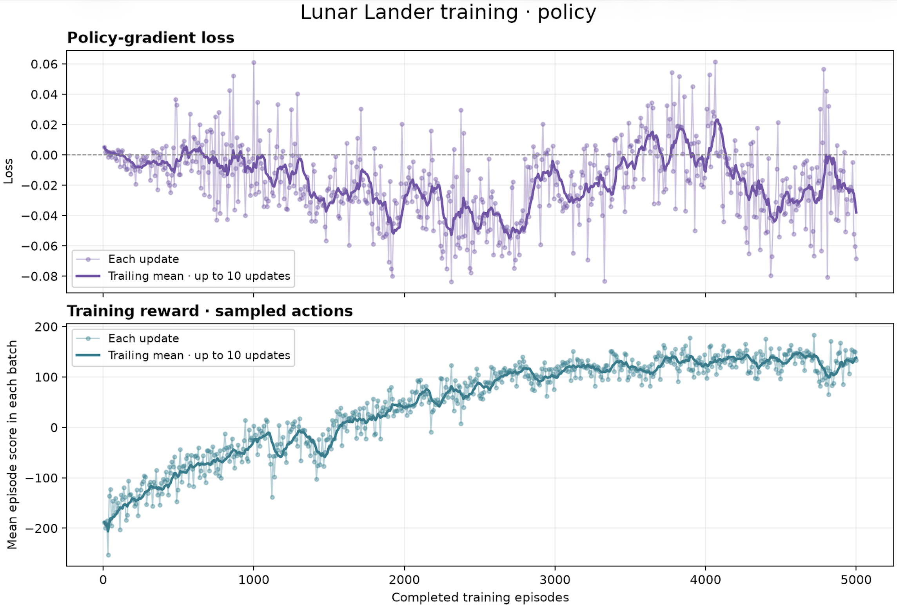

# Lunar Landing RL 🚀

Learn reinforcement learning by teaching a neural network to land a rocket in [Gymnasium's Lunar Lander](https://gymnasium.farama.org/environments/box2d/lunar_lander/).

Gymnasium provides the physics, observations, actions, and rewards. This project adds keyboard controls, a PyTorch policy network, an explained **REINFORCE** training loop, parallel episode collection, and charts. You can start by watching the environment without training anything.

## Download and run

Install [Git](https://git-scm.com/downloads) and [uv](https://docs.astral.sh/uv/getting-started/installation/), then run:

```sh
git clone https://github.com/ottobonilla95/lunar-landing-rl.git
cd lunar-landing-rl
uv sync --locked
uv run main.py --demo
```

`uv` manages Python and the project's local `.venv`; dependencies are recorded in `pyproject.toml` and pinned in `uv.lock`. The project selects Python 3.13 in `.python-version` and supports Python 3.11–3.13. You do not need to clone the Gymnasium repository.

The command opens a desktop window with Gymnasium's fixed-rule controller. It uses no neural network or training. Press **R** for another attempt and **Esc** to quit. The final scene stays visible until you restart.

A graphical desktop is required for the rocket window. Training and image generation can run without a display.

### Try the other controllers

```sh
# Fly it yourself.
uv run main.py

# Watch a fresh, untrained neural network.
uv run main.py --nn

# Print one observation and the network's action probabilities; no window.
uv run policy.py
```

| Key | Manual action |
| --- | --- |
| Up arrow | Main engine |
| Left / Right arrow | Corresponding side engine |
| No arrow | Engines off |
| R | Restart the environment |
| Esc | Quit |

Click the window to focus it. There is one discrete action per step; the main engine takes priority when multiple keys are held. None of these commands trains a network.

If you prefer `python main.py`, activate the environment after `uv sync --locked`:

```sh
# macOS / Linux
source .venv/bin/activate
python main.py --demo
```

On Windows PowerShell, activate with `.venv\Scripts\Activate.ps1` instead. The scripts are ordinary Python; `uv run` selects the correct environment for you.

## Train, then watch the saved network

First check that the full training flow works with a small run:

```sh
uv run train.py --episodes 32 --output models/smoke.pt --no-open-plot
```

This is an installation check, not enough training to learn a reliable landing. For a longer experiment:

```sh
uv run train.py --episodes 5000 --batch-size 8 --learning-rate 0.003 --gamma 0.99 --output models/ep5000-lr0003.pt
uv run main.py --nn --model models/ep5000-lr0003.pt --greedy
```

Use the **same model path** in both commands. Training saves the final model; it does not automatically select the best earlier update. Each invocation starts a fresh network. Reusing an output path replaces that run's model, CSV, and chart. Choose a new filename for each experiment.

| File from the example | Contents |
| --- | --- |
| `models/ep5000-lr0003.pt` | Weights, hidden layer sizes, and activation |
| `models/ep5000-lr0003.csv` | One row per update: completed episodes, batch mean score, loss |
| `models/ep5000-lr0003.png` | Loss and training reward curves |

After training and final evaluation, the chart opens in your image viewer. Pass `--no-open-plot` on a server or when you only want saved files. Ctrl+C during collection discards the unfinished batch and saves the last completed update.

`--greedy` chooses the most likely action. Omit it to sample actions as training does. Running `main.py` with saved weights performs inference only. Trained checkpoints are not included in this repository; `models/` and generated `visualizations/` stay local.

### Change the experiment

Edit **[config.py](config.py)** to keep settings in one place. These are the current defaults, which may differ from earlier experiments:

| Setting | Current value | Meaning |
| --- | --- | --- |
| `HIDDEN_SIZES` | `(128, 128)` | Two hidden layers, 128 neurons each |
| `ACTIVATION` | `"relu"` | Hidden activation; `"tanh"` is also supported |
| `EPISODES` | `7000` | Complete landing attempts |
| `BATCH_SIZE` | `8` | Attempts collected before one update |
| `PARALLEL_WORKERS` | `8` | CPU processes collecting episodes |
| `LEARNING_RATE` | `0.004` | Adam's learning rate |
| `GAMMA` | `0.99` | Discount applied per future step |
| `SEED` | `42` | Initial weights, training starts, and sampled actions |
| `TORCH_THREADS` | `1` | PyTorch CPU threads per process |
| `MAX_GRAD_NORM` | `1.0` | Gradient clipping limit |
| `EVALUATION_EPISODES` | `10` | Greedy test attempts before and after training |
| `EVALUATION_SEED` | `10000` | Starting seed for the fixed evaluation set |
| `OUTPUT` | `models/policy.pt` | Default output path |
| `AUTO_OPEN_PLOT` | `True` | Open the chart after training |

For example, `(64, 64)`, `(32, 32)`, or `(64,)` select other architectures. Saved models remember their own architecture even if you later change the config. Chart smoothing and visualization output paths are also configured there.

Command-line options override matching defaults for a single run:

```sh
uv run train.py --help
uv run train.py --episodes 5000 --batch-size 8 --workers 4 --learning-rate 0.003 --gamma 0.99 --seed 43 --output models/seed43.pt
```

To collect sequentially, use `--workers 1`. Parallel workers collect complete episodes with unchanged copies of the current policy. The parent waits for the batch and updates the network once. Worker count does not change the batch size or number of updates; it is capped by the batch size and episode count. The current implementation uses per-episode random seeds and preserves episode order across worker counts. This differs from older versions that used one shared random sequence.

## Recorded result

| Run | Episodes | Learning rate | Evidence |
| --- | ---: | ---: | --- |
| Shared experiment | 5,000 | 0.001 | User-supplied chart below |



The smoothed training reward rises from roughly **−200** to roughly **130–140** near the end. Improvement slows in the latter part of the run. These are approximate observations from the image, not exact statistics extracted from a CSV.

The bottom panel is the mean episode reward in each collection batch; the bold line averages up to ten updates. The top panel is policy-gradient loss. This loss can be positive or negative and does not need to decrease across batches or reach zero. Reward trends and separate evaluation scores are more useful for judging landing behavior.

**Recorded settings:** 5,000 episodes and learning rate 0.001. Architecture, batch size, gamma, seed, worker count, raw CSV, checkpoint, and evaluation scores were not supplied with this result. They are marked unknown in its [metadata](results/5000-episodes-lr-0.001.json). The current defaults do not establish the historical settings. The example training command above starts a new experiment; it does not guarantee reproduction of this chart.

This chart records training performance. It does not establish a held-out success rate or prove that the environment is solved.

### Early tuning observations

In the experiments reported during development, batch size **8** gave the highest training reward among **1, 8, 16, and 32**; batch size 1 was particularly noisy. Learning rates **0.003** and **0.004** showed promising reward curves. These are exploratory observations, not a controlled comparison across multiple seeds.

For future results, save a unique output, keep a copy of the config and exact command, and record initial/final evaluation scores. Repeat promising setups with several seeds. Add a chart and metadata using the [result template](results/README.md).

## How the files connect

```text
config.py → policy.py → train.py → models/<run>.pt → main.py --nn --model ...
                           ↑
                       rollouts.py
                           ↓
                  CSV → plot_training.py → PNG

saved model → plot_weights.py → weight heatmaps
saved model → export_model.py → Netron diagram
```

| File | Responsibility |
| --- | --- |
| `config.py` | Experiment settings and the environment interface |
| `policy.py` | Network definition, sampling example, checkpoint saving/loading |
| `main.py` | Interactive manual, fixed-rule, or neural network controller |
| `rollouts.py` | Collect complete episodes sequentially or in reusable processes |
| `train.py` | Reward-to-go, policy update, evaluation, and training loop |
| `plot_training.py` | Plot recorded loss and training reward |
| `plot_weights.py` | Plot each linear layer's connection weights |
| `export_model.py` | Export the computation graph for Netron |
| `tests/test_training.py` | Learning math, checkpoints, and collection checks |

An observation contains eight values. The network returns four action probabilities: engines off, left side engine, main engine, or right side engine. Training samples an action, gets the next observation and reward, and records the transition until the episode ends. After a batch, the network learns from discounted future rewards:

```text
G[t] = reward[t] + gamma × G[t + 1]
weights = (returns − mean(returns)) / (std(returns) + epsilon)
loss = −mean(log(probability of each action taken) × weights)
```

Returns are calculated backward within each episode. Above-average returns encourage the recorded actions; below-average returns discourage them. Adam uses the loss gradients to adjust shared weights and biases. There is no supervised list of correct actions, no value network, and no replay buffer in this introductory implementation.

For the detailed explanation of tensors, sampling, discounted returns, loss, Adam, and each training function, read the **[learning guide](docs/learning-guide.md)** alongside the commented Python files.

## Inspect a trained model

Use the path of a model you have actually trained:

```sh
# Regenerate a training chart from its CSV.
uv run plot_training.py models/ep5000-lr0003.csv

# Create PNG and SVG heatmaps; each cell is one connection weight.
uv run plot_weights.py --model models/ep5000-lr0003.pt --output visualizations/ep5000-weights.png

# Export the layer diagram, then view it with Netron.
uv run export_model.py --model models/ep5000-lr0003.pt --output models/ep5000-diagram.pt2
uvx netron models/ep5000-diagram.pt2 --port 8080
```

Open [localhost:8080](http://127.0.0.1:8080/) while Netron runs. Heatmap colors describe parameter values, not landing quality. Netron is an optional viewer, fetched separately by `uvx`.

## Let your coding agent set it up

Copy this message into your coding agent:

> Clone https://github.com/ottobonilla95/lunar-landing-rl.git into a new local directory, enter it, and read AGENTS.md and README.md. Use uv sync --locked, then run uv run python -m unittest discover -s tests -v. If uv is missing, follow its official installation instructions. On a graphical desktop, launch uv run main.py --demo so I can watch the fixed-rule lander. If no display is available, run uv run policy.py instead and explain that the rocket window requires a desktop. Do not start a training run yet. Tell me where the project is and the commands to run it myself.

When you want the agent to train:

> In lunar-landing-rl, read AGENTS.md and README.md. Train a fresh policy for 5,000 episodes with batch size 8, learning rate 0.003, and gamma 0.99. Keep the architecture from config.py and report it. Choose a new unused output filename under models/ so existing results are preserved. Record the effective config, exact command, console output, CSV, chart, and initial/final greedy evaluation scores. Use --no-open-plot without a desktop. After training, tell me the path and the matching uv run main.py --nn --model PATH --greedy command. Do not claim the training reward is a separate evaluation score.

## Check the implementation

```sh
uv run python -m unittest discover -s tests -v
```

The tests cover discounted returns, update direction, equal-return stability, checkpoint compatibility, output/config behavior, episode termination, and matching sequential/parallel collection. A short training run checks the plumbing; it does not measure long-run learning quality.

Built with [Gymnasium](https://github.com/Farama-Foundation/Gymnasium), [PyTorch](https://pytorch.org/), and [Matplotlib](https://matplotlib.org/). The policy-gradient explanation follows [OpenAI Spinning Up](https://spinningup.openai.com/en/latest/spinningup/rl_intro3.html).
