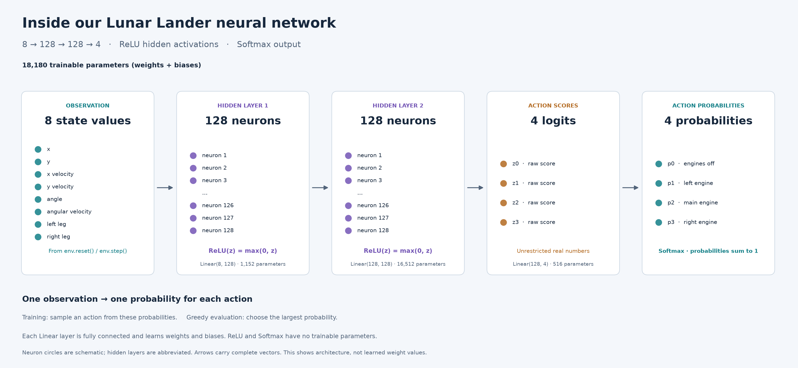

# Lunar Landing RL 🚀

Learn reinforcement learning by teaching a neural network to land a rocket in [Gymnasium's Lunar Lander](https://gymnasium.farama.org/environments/box2d/lunar_lander/).

Gymnasium supplies the simulation and rewards. This project adds keyboard controls, a PyTorch neural network, an explained **REINFORCE** trainer, parallel episode collection, and charts. Start with a demo; train when you are ready.

## Get started

Choose **[a coding agent](#option-1-use-a-coding-agent-recommended)** for guided setup, or **[set it up manually](#option-2-set-it-up-manually)**.

### Option 1: Use a coding agent (recommended)

Copy this into your coding agent:

```text
Help me set up and understand this educational reinforcement-learning project:
https://github.com/ottobonilla95/lunar-landing-rl

Check my OS, Git, and uv; use their official installation instructions if needed:
https://git-scm.com/downloads
https://docs.astral.sh/uv/getting-started/installation/
Clone into a new folder, or reuse my existing checkout while preserving changes.
Read AGENTS.md, README.md, docs/learning-guide.md, and the relevant Python files.

Run uv sync --locked, then uv run python -m unittest discover -s tests -v.
On a graphical desktop, launch uv run main.py --demo. Without a display, run
uv run policy.py and explain how to open the rocket window on a desktop.

Give me a beginner-friendly summary: what the project does, its local folder,
the current network and settings from config.py, manual/demo/untrained/trained
modes, controls, and where model/CSV/chart files go. Show the exact commands to
run, train, and watch a saved network, using the same new model path for both.
Explain training reward versus greedy evaluation. Report any setup/test failures.
Do not start training until I ask, and preserve existing models and results.
```

### Option 2: Set it up manually

Install [Git](https://git-scm.com/downloads) and [uv](https://docs.astral.sh/uv/getting-started/installation/), then:

```sh
git clone https://github.com/ottobonilla95/lunar-landing-rl.git
cd lunar-landing-rl
uv sync --locked
uv run main.py --demo
```

`uv` manages Python and dependencies in a local `.venv`; the project selects Python 3.13. The demo opens a fixed-rule controller with no training. A graphical desktop is required; without one, try `uv run policy.py`.

| Mode | Command |
| --- | --- |
| Fly manually | `uv run main.py` |
| Watch the fixed-rule controller | `uv run main.py --demo` |
| Watch an untrained network | `uv run main.py --nn` |

Click the window to focus it. **Up** fires the main engine; **Left/Right** fire side engines. **R** restarts; **Esc** quits. These modes do not train the network.

## Our neural network



**8 → 128 → 128 → 4**, with **ReLU** hidden activations, **Softmax** action probabilities, and **18,180 trainable weights and biases**. Hidden circles are abbreviated; linear layers are fully connected. Saved checkpoints retain their own architecture. [Vector diagram](docs/images/policy-architecture.svg).

## Train, then watch

A short check that training runs:

```sh
uv run train.py --episodes 32 --output models/smoke.pt --no-open-plot
```

For a longer experiment, train and then load that exact model:

```sh
uv run train.py --episodes 5000 --batch-size 8 --learning-rate 0.003 --gamma 0.99 --output models/experiment.pt
uv run main.py --nn --model models/experiment.pt --greedy
```

Each training command starts a **fresh network**. Use a new output name each time: this example writes `models/experiment.pt` (weights and architecture), `.csv` (progress), and `.png` (loss/reward curves). Training saves the final policy, not the best earlier one. Trained models are not included in the repo.

The chart opens after training and final evaluation; `--no-open-plot` saves it without opening. `--greedy` picks the most likely action; omit it to sample actions.

Edit **[config.py](config.py)** for hidden layers, activation, episodes, batch size, learning rate, gamma, workers, and seed. CLI options override matching settings for one run; see `uv run train.py --help`. Without `--output`, training saves to the configured path, currently `models/policy.pt`. Parallel workers collect complete episodes, followed by one update per batch; `--workers 1` runs sequentially.

## Recorded results

All runs below used **5,000 episodes**. Open a chart, or browse the **[full experiment gallery and notes](results/README.md)**.

| Learning rate | Gamma | Chart and settings |
| ---: | ---: | --- |
| 0.001 | 0.99 | [Chart](results/5000-episodes-lr-0.001.png) · [Metadata](results/5000-episodes-lr-0.001.json) |
| 0.002 | 0.99 | [Chart](results/5000-episodes-lr-0.002.png) · [Metadata](results/5000-episodes-lr-0.002.json) |
| 0.003 | 0.99 | [Chart](results/5000-episodes-lr-0.003.png) · [Metadata](results/5000-episodes-lr-0.003.json) |
| 0.004 | 0.99 | [Chart](results/5000-episodes-lr-0.004.png) · [Metadata](results/5000-episodes-lr-0.004.json) |
| 0.005 | 0.99 | [Chart](results/5000-episodes-lr-0.005.png) · [Metadata](results/5000-episodes-lr-0.005.json) |
| 0.009 | 0.99 | [Chart](results/5000-episodes-lr-0.009.png) · [Metadata](results/5000-episodes-lr-0.009.json) |
| 0.001 | 0.79 | [Chart](results/5000-episodes-lr-0.001-gamma-0.79.png) · [Metadata](results/5000-episodes-lr-0.001-gamma-0.79.json) |

The **0.003 / 0.99** run finished with the highest smoothed training reward among these charts. These are individual exploratory runs; architecture, batch size, seed, and separate evaluation scores were not recorded with the images. They do not establish a reliable ranking or success rate. Policy-gradient loss need not decrease toward zero; judge learning with rewards and separate evaluation.

## Explore further

- **[Learning guide](docs/learning-guide.md):** how the network, discounted returns, loss, and optimizer work, function by function.
- **[Commands and project reference](docs/usage.md):** settings, file map, Python activation, heatmaps, architecture diagrams, Netron, and an agent training prompt.
- **[Experiment gallery](results/README.md):** all seven charts, observations, metadata, and a template for recording more runs.

Run the implementation checks with `uv run python -m unittest discover -s tests -v`.

Built with [Gymnasium](https://github.com/Farama-Foundation/Gymnasium), [PyTorch](https://pytorch.org/), and [Matplotlib](https://matplotlib.org/).
