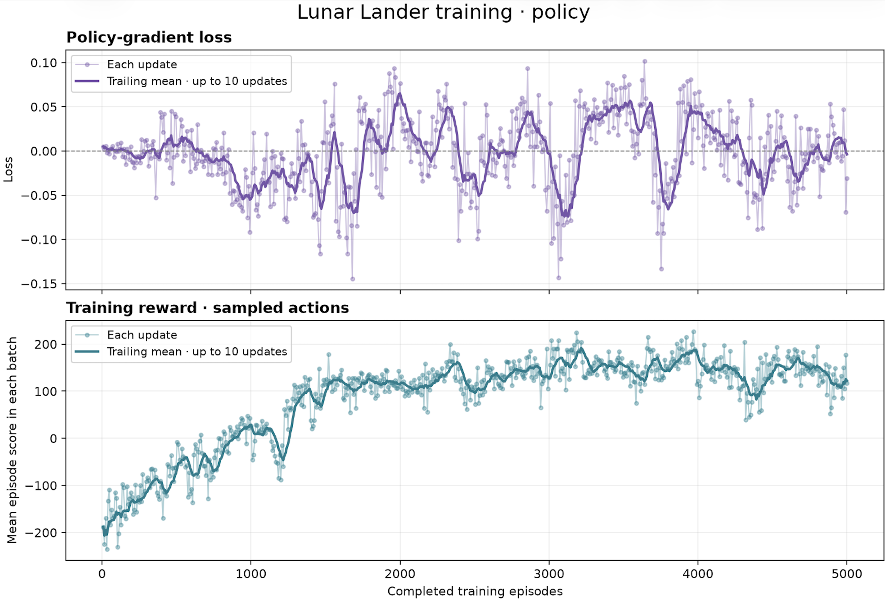
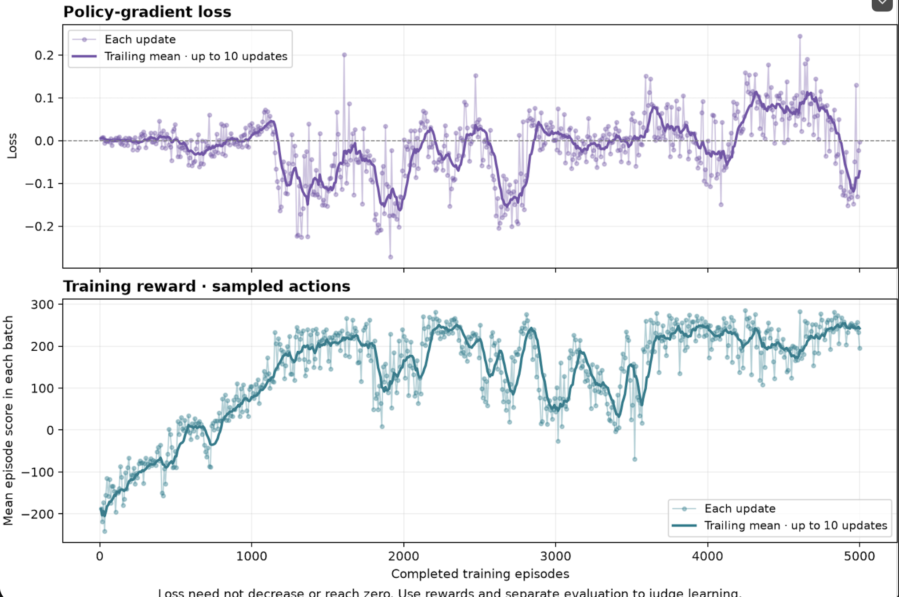
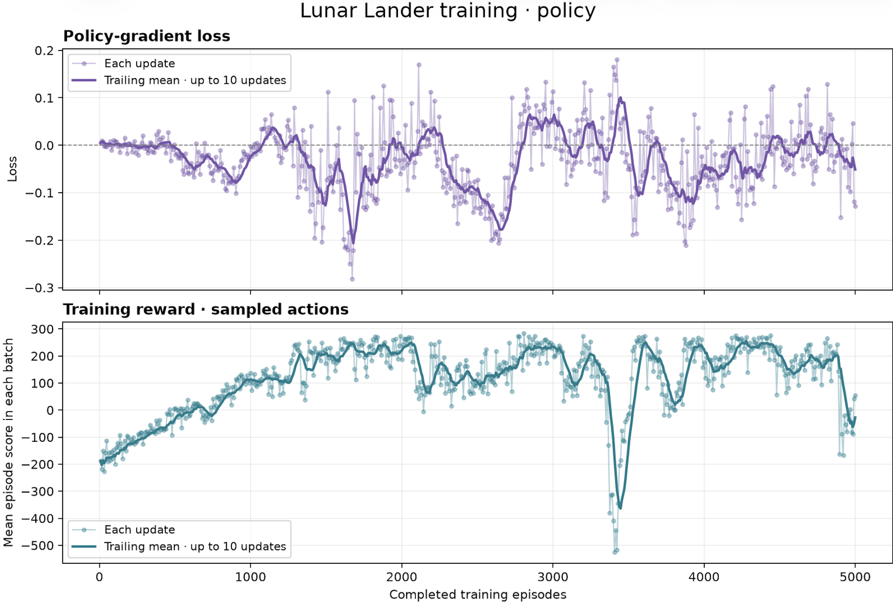
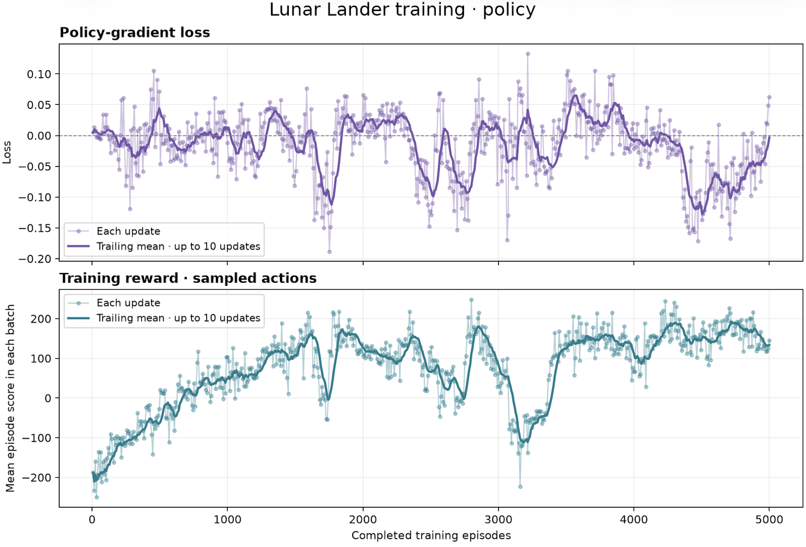
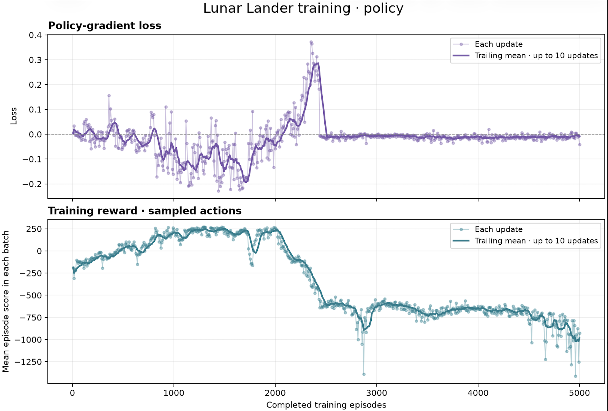
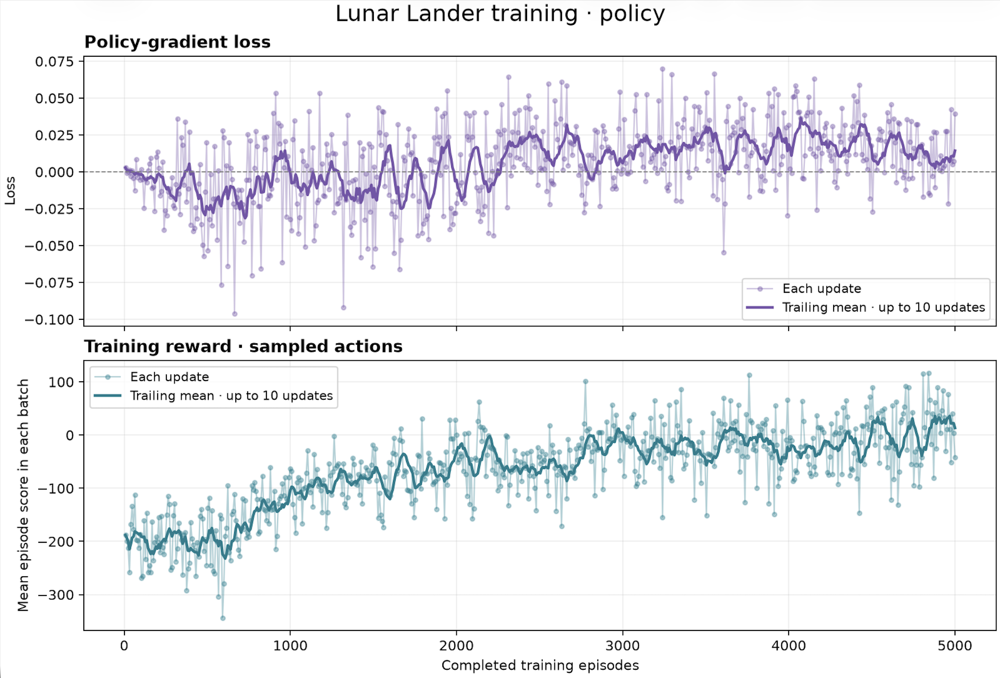

# Experiment records

[Back to the project](../README.md) · All seven published runs and their supplied charts are preserved below.

## Recorded results

| Run | Episodes | Learning rate | Gamma | Evidence |
| --- | ---: | ---: | ---: | --- |
| LR 0.001 | 5,000 | 0.001 | 0.99 | [Chart](5000-episodes-lr-0.001.png) · [Metadata](5000-episodes-lr-0.001.json) |
| LR 0.002 | 5,000 | 0.002 | 0.99 | [Chart](5000-episodes-lr-0.002.png) · [Metadata](5000-episodes-lr-0.002.json) |
| LR 0.003 | 5,000 | 0.003 | 0.99 | [Chart](5000-episodes-lr-0.003.png) · [Metadata](5000-episodes-lr-0.003.json) |
| LR 0.004 | 5,000 | 0.004 | 0.99 | [Chart](5000-episodes-lr-0.004.png) · [Metadata](5000-episodes-lr-0.004.json) |
| LR 0.005 | 5,000 | 0.005 | 0.99 | [Chart](5000-episodes-lr-0.005.png) · [Metadata](5000-episodes-lr-0.005.json) |
| LR 0.009 | 5,000 | 0.009 | 0.99 | [Chart](5000-episodes-lr-0.009.png) · [Metadata](5000-episodes-lr-0.009.json) |
| LR 0.001, gamma 0.79 | 5,000 | 0.001 | 0.79 | [Chart](5000-episodes-lr-0.001-gamma-0.79.png) · [Metadata](5000-episodes-lr-0.001-gamma-0.79.json) |

### 5,000 episodes · learning rate 0.001 · gamma 0.99

The smoothed training reward rises from roughly **−200** to roughly **130–140** near the end. Improvement slows in the latter part of the run.

### 5,000 episodes · learning rate 0.002 · gamma 0.99

The smoothed training reward reaches roughly **100** around episode **1,400**, fluctuates mostly around **100–190** afterward, and ends around **110–120**. It reaches positive rewards earlier than the 0.001 run but finishes with a lower smoothed reward. These are approximate observations from the supplied images, not exact statistics extracted from CSVs, and do not establish which learning rate is better across repeated runs.

### 5,000 episodes · learning rate 0.003 · gamma 0.99

The smoothed training reward reaches roughly **200** around episode **1,400** and ends around **240–250**, with substantial drops and recoveries in between. This run finishes with the highest final smoothed training reward of the seven published charts. These are approximate readings from the image; these individual runs do not establish a reliable ranking of settings.

### 5,000 episodes · learning rate 0.004 · gamma 0.99

The smoothed training reward repeatedly reaches roughly **200–250**, but drops to roughly **−350** around episode **3,450**. It recovers, then ends **below zero** after another late drop. This run shows that strong intermediate rewards can be lost before training finishes. These are approximate observations from the image, not exact CSV statistics or a separate evaluation of the final model.

### 5,000 episodes · learning rate 0.005 · gamma 0.99

The smoothed training reward rises from roughly **−200**, reaches peaks around **180–190**, and drops to roughly **−110** near episode **3,200** before recovering. It ends around **130–140**, below its earlier peaks. These are approximate readings from the image, not exact CSV statistics or a separate evaluation of the final model.

### 5,000 episodes · learning rate 0.009 · gamma 0.99

The smoothed training reward reaches roughly **250** before episode **2,000**, then deteriorates sharply and ends around **−1,000**. After roughly episode **2,500**, the loss stays close to zero while rewards remain strongly negative: near-zero policy-gradient loss does not indicate successful learning. These are approximate observations from the image, not exact CSV statistics or a diagnosis of the underlying cause.

### 5,000 episodes · learning rate 0.001 · gamma 0.79

The smoothed training reward starts around **−200**, approaches zero later in the run, and ends slightly positive with continued fluctuations. It finishes below the earlier 0.001 run with gamma 0.99. These are approximate observations from the image; the charts alone do not isolate gamma's effect or provide a separate evaluation score.

The bottom panel is the mean episode reward in each collection batch; the bold line averages up to ten updates. The top panel is policy-gradient loss. This loss can be positive or negative and does not need to decrease across batches or reach zero. Reward trends and separate evaluation scores are more useful for judging landing behavior.

**Recorded settings:** all seven runs have 5,000 episodes. The first six use learning rates 0.001, 0.002, 0.003, 0.004, 0.005, and 0.009; all six use gamma 0.99, as confirmed by the user. The seventh uses learning rate 0.001 and gamma 0.79. Architecture, batch size, seed, worker count, raw CSV, checkpoint, and evaluation scores were not supplied with these results. They are marked unknown in each run's metadata. The current defaults do not establish the historical settings. The example training command above starts a new experiment; it does not guarantee reproduction of these charts.

These charts record training performance. They do not establish a held-out success rate or prove that the environment is solved.

### Early tuning observations

In the experiments reported during development, batch size **8** gave the highest training reward among **1, 8, 16, and 32**; batch size 1 was particularly noisy. Learning rates **0.003** and **0.004** showed promising reward curves. These are exploratory observations, not a controlled comparison across multiple seeds.

For future results, save a unique output, keep a copy of the config and exact command, and record initial/final evaluation scores. Repeat promising setups with several seeds. Add a chart and metadata using the [result template](#new-result-template).

## Record another experiment

For each new experiment:

1. Choose a unique `--output models/<run>.pt` so earlier runs survive.
2. Save the exact command and a copy of `config.py` before training. CLI overrides are part of the effective settings.
3. Save console output, including initial/final greedy evaluation means.
4. Copy the chart and CSV into `results/<run>/` if you want them published. Keep large checkpoints local unless publication is explicitly requested.
5. Fill in the record below, add the chart and notes to this page, and add a linked row to the root README. Leave unavailable values unknown rather than inferring them from current defaults.

## New result template

- Run ID:
- Code commit:
- Exact command:
- Episodes completed:
- Hidden layers / activation:
- Batch size / workers:
- Learning rate / gamma / seed:
- Gradient clipping / PyTorch thread count:
- Python, dependency versions, OS, hardware, elapsed time:
- Initial/final greedy evaluation mean:
- Evaluation episode count / starting seed:
- Training chart / raw CSV:
- Config snapshot / console log:
- Notes and limitations:

Training reward uses sampled actions. The trainer prints separate greedy evaluation means before and after training on the same fixed starts. Repeatedly tuning against those starts makes them a development set; use additional fresh seeds for a final assessment. Single runs and peaks do not establish that one setup is best.
